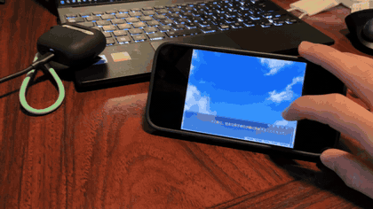
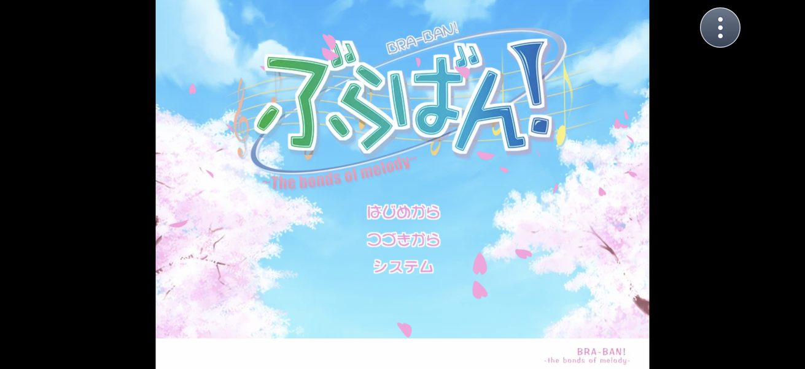
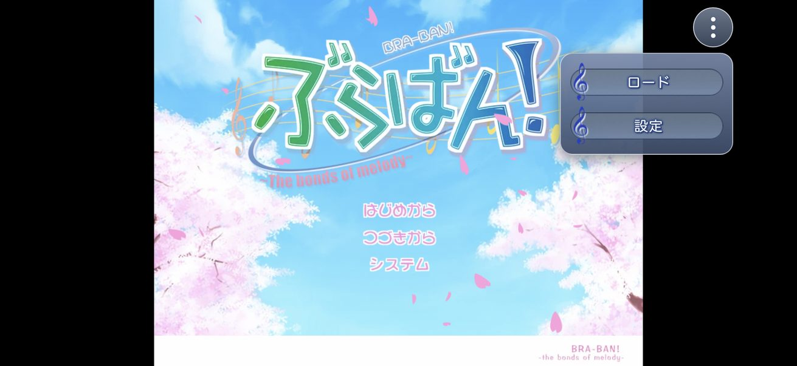
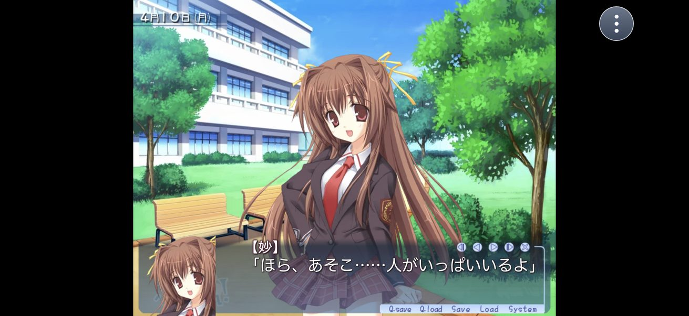
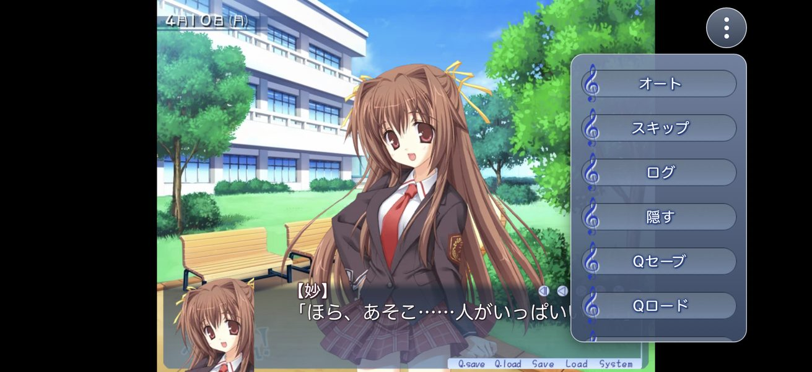
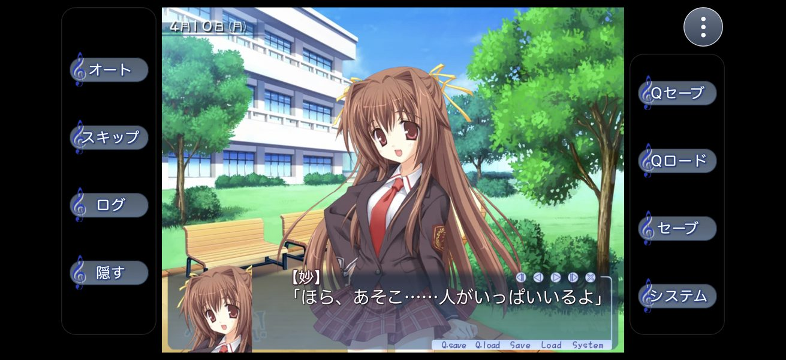
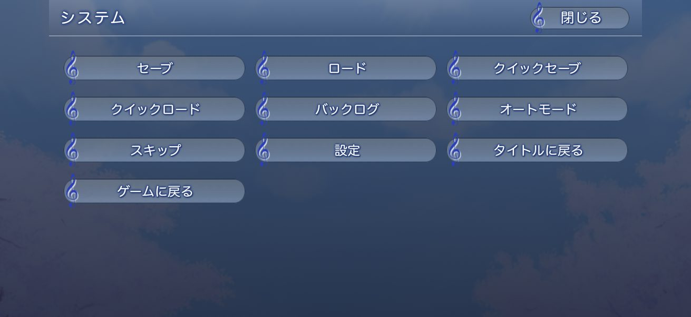
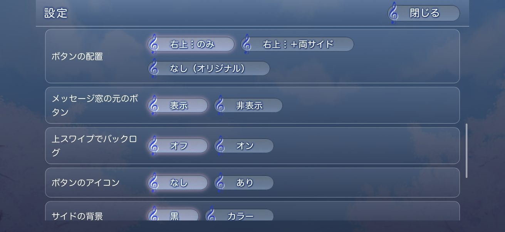
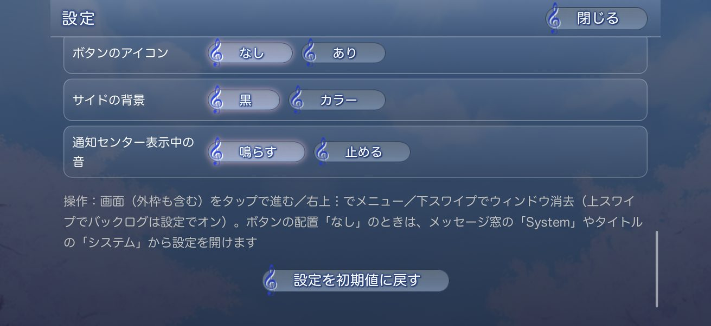

# yuzusoft-braban-ios-revers

ゆずソフト（YUZUSOFT）「ぶらばん！」PC 版（吉里吉里Z、2021年再販版）を、所有しているディスクイメージから
iPhone / iPad で遊べる iOS アプリにするまでの**リバースエンジニアリング手順とツール**です。

- 手順の詳細：[docs/REVERSE_ENGINEERING.md](docs/REVERSE_ENGINEERING.md)
- ゲームのデータ・復号鍵・変換済み素材・IPA は**含みません**。手元のディスクから作り直します。

## 実機での動作（iPhone 17 Pro / iOS 27、LiveContainer）



| タイトル | タイトルの︙メニュー（ロード / 設定） |
|---|---|
|  |  |

| ゲーム画面（右上︙のみ・初期設定） | ︙メニュー |
|---|---|
|  |  |

| 両サイドにボタン（オリジナルの選択肢バーを流用） | ボタン配置「なし（オリジナル）」 |
|---|---|
|  |  |

| システムメニュー | 設定（文字の大きさ・レイアウトなど） |
|---|---|
|  |  |

| 設定（ボタンの配置・アイコン・サイド背景・通知センター時の音） |
|---|
|  |

## 構成

```
tools/   復号・名前復元・素材変換・検証・ビルド補助のスクリプト
game/    HTML5 製の KAG / KAGEX 互換エンジン（index.html, js/, css/）
         ※ data/ i/ s/ v/ は build_assets.py が生成（リポジトリには含めない）
ios/     SwiftUI + WKWebView のアプリ（ネイティブ音声 AVAudioEngine）
docs/    手順書・スクリーンショット
```

## 流れ（概要）

1. ISO を 7-Zip で展開
2. ゲームを Frida 付きで起動して Hxv4 の鍵を取り出す（`tools/dumpkey.py`）
3. 全 XP3 を復号（`tools/extract_all.ps1`）
4. ハッシュ化されたファイル名を復元（`tools/unhash.py`, `tools/unhash2.py`）
5. 画像 WebP / 音声 AAC / 動画 H.264 に変換（`tools/build_assets.py`）
6. ブラウザで確認（`node tools/serve.js`、`node tools/check_scripts.js`）
7. WSL + xtool で未署名 IPA を作成（`tools/sync_ios.sh` → `build_ipa.py` → `tools/dedup_package.py`）
8. LiveContainer の書類フォルダへ USB 転送して起動

## 必要なもの

- Windows 11、7-Zip、Python 3.12、Node.js、ffmpeg
- Frida（`pip install frida-tools`）、pycryptodome、siphash、Pillow
- 外部スクリプト：[YuriSizuku/GalgameReverse](https://github.com/YuriSizuku/GalgameReverse) の `project/krkr/src/`（`ext/GalgameReverse` に clone して使う）
- iOS ビルド（Mac 不要）：Windows の WSL2 に Arch Linux を入れ、Swift 6.4・xtool・Apple SDK（公式の Xcode から生成）を用意する。
  構築からビルドまでの手順は [hinatamaxxx/windows-ipa-build-guide](https://github.com/hinatamaxxx/windows-ipa-build-guide) にまとめてある（この移植で使った `build_ipa.py` もここに入っている）。
  土台は [joshuaswarren/omarchy-apple-dev](https://github.com/joshuaswarren/omarchy-apple-dev) と [xtool](https://github.com/xtool-org/xtool)。
- iPhone：AltStore 経由の LiveContainer、`pymobiledevice3`

## 注意

個人で所有しているゲームを、自分の端末で遊ぶための記録です。
ゲームのデータ、復号鍵、変換済み素材、それらを含む IPA は配布しないでください。
スクリーンショットとGIFは動作確認の記録として載せています（ゲームの画像の権利はゆずソフトにあります）。
